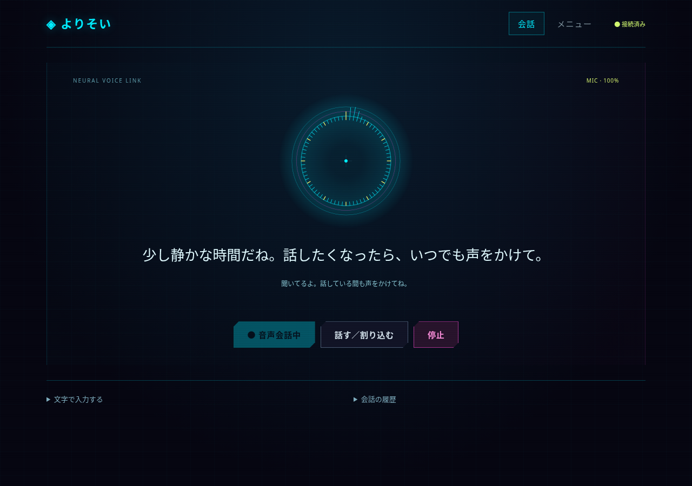

# よりそい — Cyber / Duplex v0.5.0

[Windows更新版ZIP](https://github.com/ej91tt0tt0/Codex/raw/refs/heads/main/downloads/yorisoi-windows-cyber.zip)

[青年らしい声の試聴（MP3）](https://github.com/ej91tt0tt0/Codex/raw/refs/heads/main/downloads/yorisoi-young-man.mp3)

## 今回の改善

- 声を `ash` に変更し、高すぎない青年らしい中低音に調整。速度1.12、感情表現、タメ口は維持。
- 高精度モードではAIの発声中もマイクを動かし、話し始めると読み上げを自動停止。認識した追加・訂正を次の返答へ反映。
- 返答待ちに届いた発言も捨てずに待ち行列へ保持し、順序に沿ってまとめて返答。
- 日本語の認識はOpenAI `gpt-4o-transcribe` を使用。約350msのプリロールで語頭を残し、エコー抑制・ノイズ抑制・自動音量調整を使用。
- シアン・マゼンタのサイバーパンク風UIに変更。中央の円形オブジェクトはマイクの実測音量・周波数に反応。ランダムな疑似音量ではない。

## 更新・起動

1. 旧版を黒い画面でCtrl+Cを押して終了。
2. ZIPを「すべて展開」し、`yorisoi` の中身を既存の `yorisoi` フォルダーへ上書き。既存の `.data` は削除しないでください。
3. `start_windows.bat` を開き、OpenAI APIキーを入力してEnter。
4. ChromeまたはEdgeで「音声会話を開始」を押し、マイクを許可してください。

Python 3.12以上が必要です。APIキーは非表示で、ファイルには保存しません。メニューの「高精度な日本語認識・発話中も聞き取る」は既定でオンです。メニュー移動・別タブへの移動・停止ボタンでマイクと再生を停止します。停止後に許可の応答や認識結果が遅れて届いても、勝手に再開・再生しません。

## 音声認識の動作と制限

無音が約1秒続くか、20秒話すごとに音声をOpenAIへ送信し、認識結果を会話へ渡します。認識中も録音を続け、AIの声に話しかけた場合は読み上げを止めて交代します。無遅延の常時全二重通話ではありません。ネットワークや音響環境で精度・待ち時間は変わります。スピーカー音の回り込みを減らすため、ヘッドセットの使用がおすすめです。

高精度認識をオフにすると旧ブラウザ認識方式へ戻ります。この方式は発声中の認識・マイク音量表示には未対応です。自然音声を使えない場合はブラウザ音声を使用し、インストール済みなら日本語の男性音声を優先します。OS側により声質は異なります。

自動の独り言・話題提案（既定3分、無応答時最大3回）は維持。発言や認識が進行中は割り込まず、停止するとタイマーも止まります。

## 料金・情報の扱い

**高精度認識は録音した音声をOpenAIへ送信し、認識APIの追加料金が発生します。** 会話・自然音声にもそれぞれAPI料金が発生します。自然音声では読み上げる文章を送信。旧ブラウザ認識ではブラウザ提供元へ音声が送信される場合があります。

録音はメモリー上だけで扱い、アプリは録音ファイルをディスクへ保存しません。認識した文字は会話として保存します。AI利用時は会話・記憶・最近の体調・地域・天気・ニュースをOpenAIへ送信します。ZIPにAPIキー・実際の履歴・体調記録は含めません。地域の初期設定（愛知県碧南市浜田町、名鉄三河線など）は含みます。クラウドのキーや履歴はPCに引き継がれません。医療の診断や緊急対応を行うアプリではありません。

## 検証とサンプル

サーバー14件、音声制御・録音処理27件、計41件の自動テストを実施。配布ZIPを展開した状態で、実際のAudioWorkletと合成マイク入力による音量表示・自動割り込み・追加発言・停止時のトラック解放・旧データ保持をChromiumで確認。ブラウザ試験の文字起こしとAI応答は模擬です。声の生成・日本語認識は実OpenAI APIでも検証し、「名鉄三河線」「国道23号」の認識を確認しました。

MP3は実APIで生成した試聴用音声です。画像は合成マイク入力での試験画面で、実ユーザーの会話ではありません。Windows実機のマイク・スピーカーでは未検証です。配布物のSHA-256は `SHA256SUMS` を参照してください。
