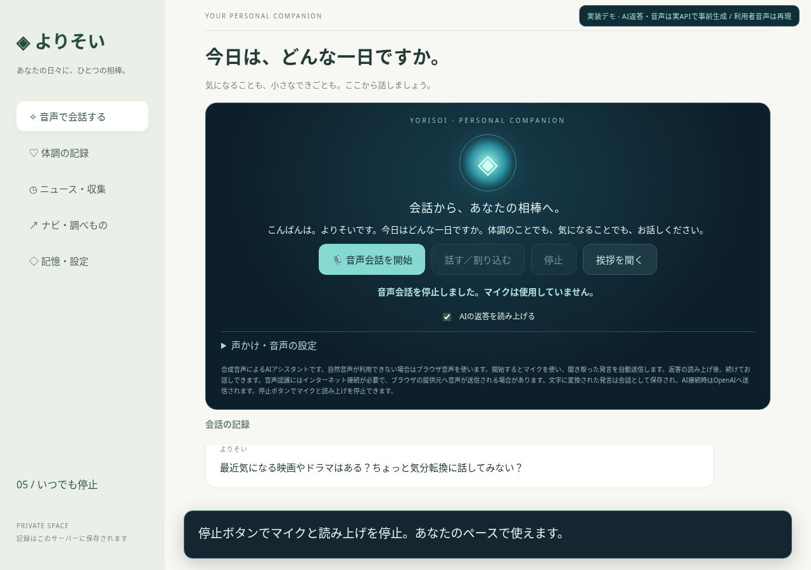

# よりそい — 相棒モード v0.3.0

[Windows更新版ZIPをダウンロード](https://github.com/ej91tt0tt0/Codex/raw/refs/heads/main/downloads/yorisoi-windows-companion.zip)

[サンプル動画を見る・ダウンロード（MP4・約75秒）](https://github.com/ej91tt0tt0/Codex/raw/refs/heads/main/downloads/yorisoi-companion-demo.mp4)

## 今回追加した機能

- 落ち着いたAI音声（OpenAI gpt-4o-mini-tts / cedar）と、短い口語の返答。
- 音声会話中、既定3分間静かになると「短い独り言」「次の話題の提案」を交互に生成。
- 間隔は1・3・5・10分から選択。返事がないまま3回続くと休止し、ユーザーの発言後に再開。
- 「話す／割り込む」で読み上げを止めて聞き取りへ戻る操作。
- 「停止」やタブ移動でマイク・音声・自動の声かけを停止。応答待ちで停止した場合も、後から勝手に読み上げません。

声かけは表示中のブラウザとサーバーが稼働し、音声会話モードが有効な間だけ動作します。「声かけ・音声の設定」で自動発話・自然音声をオフにできます。人間による通話や特定の映画・俳優の声の模倣ではありません。声だけでの自動割り込みや、無遅延の全二重会話は未対応です。

## 動画の内容と再現条件

起動時の挨拶、疲れた日のやり取り、独り言、話題の提案、停止を収録した画面デモです。AIの返答と音声は実際のOpenAI APIで事前生成したものを再生しています。利用者の発言・音声は架空のサンプルで、マイク入力は模擬しています。待機時間は撮影用に5秒へ短縮しています。本番の既定は3分です。動画に実ユーザーの会話履歴・健康記録・APIキーは含めていません。

## 更新・起動

1. 旧版の黒い画面でCtrl+Cを押して終了。
2. ZIPを「すべて展開」し、`yorisoi` の中身を既存の `yorisoi` フォルダーへ上書き。既存の `.data` フォルダーは削除しないでください。
3. `start_windows.bat` を開き、OpenAI APIキーを入力してEnter。キーは非表示で、ファイルには保存しません。
4. Windows版ChromeまたはEdgeで「音声会話を開始」を押し、マイクを許可してください。

Python 3.12以上が必要です。起動時の自動挨拶がブラウザに制限された場合は「挨拶を聞く」を押します。音声認識非対応の場合はChrome／Edgeをお試しください。文字入力も利用できます。終了はCtrl+Cです。

## 利用料金・プライバシー

自然音声は会話APIと別にOpenAI APIの従量課金が発生し、読み上げる文章をOpenAIに送信します。音声認識ではブラウザ提供元へ音声が送信される場合があります。アプリには録音ファイルを保存しません。AI利用時は会話・記憶・最近の体調・対象地域・天気・ニュースをOpenAIに送信します。自然音声が利用できない場合はブラウザ音声へ切り替えます。

ZIPにAPIキー・会話履歴・体調記録は含みません。対象地域の初期設定（愛知県碧南市浜田町、名鉄三河線など）は含みます。クラウドのキーはPCに引き継がれません。PC内だけで動く開発用アプリで、インターネット公開は行いません。医療の診断・緊急対応を行うアプリではありません。

## 検証

サーバー12件・音声制御17件の自動テストを実施。Chromiumでの画面操作と自動の声かけ、実OpenAI APIによる返答・自然音声生成を確認しています。Windows実機のマイク・スピーカーでは未検証です。ZIPとMP4のSHA-256は `SHA256SUMS` を参照してください。
