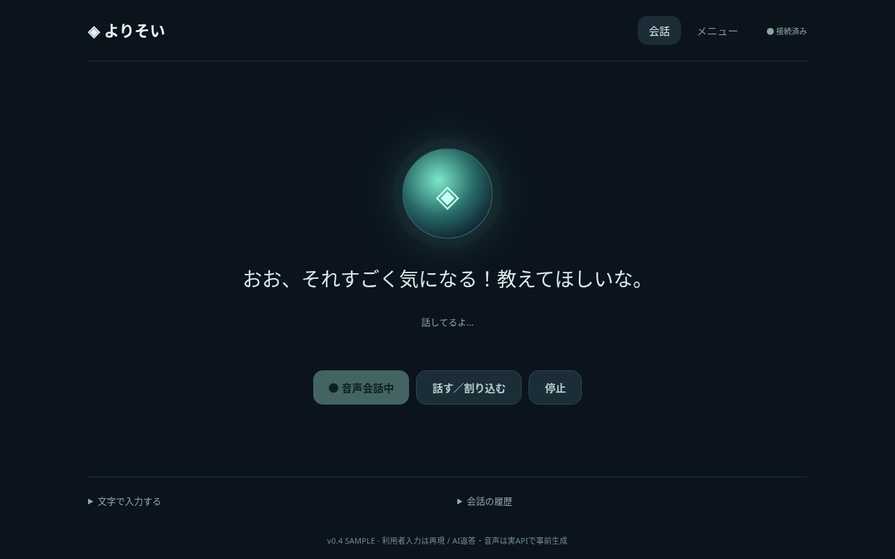

# よりそい — シンプル音声版 v0.4.0

[約10秒の音声付きサンプル動画（MP4）](https://github.com/ej91tt0tt0/Codex/raw/refs/heads/main/downloads/yorisoi-simple-10s.mp4)

[Windows更新版ZIP](https://github.com/ej91tt0tt0/Codex/raw/refs/heads/main/downloads/yorisoi-windows-simple.zip)

## 今回の変更

- 自然音声を若々しく明るい雰囲気の `shimmer` に変更。速度は1.12倍。
- 喜ぶときは弾む声、共感するときは柔らかな声になるよう指示。基本は敬語を使わない親しみやすい口調。
- メイン画面は会話の開始・割り込み・停止、最新の返答、必要なときに開く文字入力・履歴に整理。
- 体調記録、天気・ニュース・交通、ナビ、記憶、音声設定は「メニュー」に移動。

自動の声かけ（既定3分、1/3/5/10分から選択、無応答時最大3回）は引き続き利用できます。メニューを開く、停止する、別タブに移ると音声会話も停止します。読み上げへの割り込みは「話す／割り込む」ボタンで行います。声だけでの割り込みや全二重の会話には未対応です。

## 動画

約10秒の画面デモです。新しい声・速度・感情表現での挨拶と短い返答を収録しています。AIの返答と音声は実OpenAI APIで事前生成したものを再生し、利用者の発言とマイク入力はサンプルとして再現しています。個人の実際の会話やAPIキーは含みません。

## 更新・起動

1. 旧版を黒い画面でCtrl+Cを押して終了。
2. ZIPを「すべて展開」し、`yorisoi` の中身を既存の `yorisoi` フォルダーへ上書き。既存の `.data` フォルダーは削除しないでください。
3. `start_windows.bat` を開き、OpenAI APIキーを入力してEnter。
4. ChromeまたはEdgeで「音声会話を開始」を押し、マイクを許可してください。

Python 3.12以上が必要です。APIキーは非表示で入力し、ファイルには保存しません。空欄でEnterを押すと記録モードで起動します。起動時の自動音声が制限された場合は、メニューの「挨拶を聞く」を押してください。

## 料金・情報の取り扱い

OpenAIの会話APIと自然音声API（gpt-4o-mini-tts）は別々に従量課金が発生します。自然音声では読み上げる文章をOpenAIに送信します。音声認識ではブラウザ提供元へ音声が送信される場合があります。アプリには録音ファイルを保存せず、認識した文字を保存します。AI利用時は会話・記憶・最近の体調・対象地域・天気・ニュースをOpenAIへ送信します。自然音声が利用できないときはブラウザ音声に切り替えます。ブラウザ音声の声質はOS側の音声によります。

ZIPにAPIキー・実際の会話履歴・体調記録は含めません。地域の初期設定（愛知県碧南市浜田町、名鉄三河線など）は含みます。クラウド側のキーや履歴はPCへ引き継がれません。PC内だけで動く試作版で、人間の通話や医療の診断・緊急対応を行うものではありません。

## 検証

自動テスト29件、Chromiumでの会話操作・メニュー遷移・自動発話・モバイル幅を検証。自然音声生成は実APIで確認しました。Windows実機でのマイク・スピーカー検証は未実施です。配布物のSHA-256は `SHA256SUMS` を参照してください。
